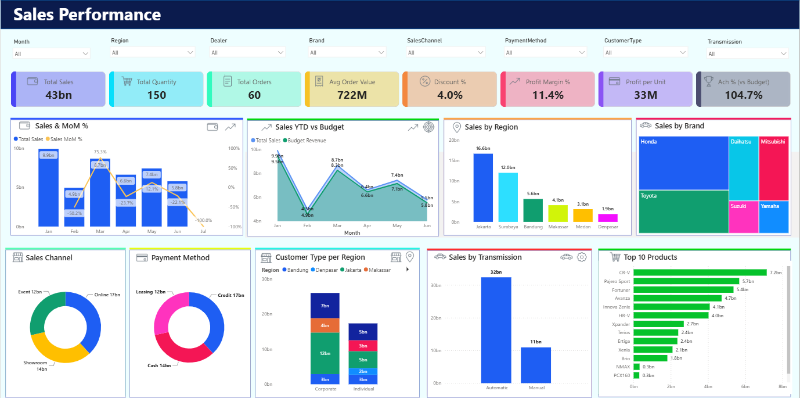
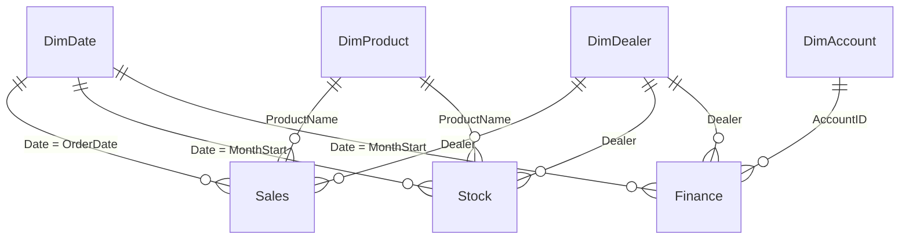

# Elektromart Sales Dashboard

Dashboard analitik penjualan, stok, dan keuangan dealer kendaraan yang dibuat di **Microsoft Power BI**. Satu model data menggabungkan tiga area, yaitu penjualan, persediaan, dan laporan keuangan, lalu menampilkannya dalam satu halaman dengan 8 slicer.

> Data bersifat **sintetis (fiktif)** dan dibuat untuk latihan analisis. Data sudah tertanam di dalam file `.pbix`, jadi tidak perlu koneksi ke sumber luar.

File: [`Dashboard Sales.pbix`](Dashboard%20Sales.pbix). Buka dengan Power BI Desktop.

## Tampilan Dashboard

## Ringkasan Data

| Item | Isi |
|---|---|
| Periode | 1 Januari 2026 sampai 31 Desember 2026 |
| Transaksi penjualan | 60 order, 150 unit |
| Dealer | 10 dealer di 6 wilayah (Jakarta, Bandung, Surabaya, Medan, Makassar, Denpasar), tipe Main Dealer dan Sub Dealer |
| Produk | 14 produk dari 6 merek (Toyota, Honda, Daihatsu, Mitsubishi, Suzuki, Yamaha), kategori Car dan Motorcycle, bahan bakar Gasoline, Diesel, dan Hybrid |
| Stok bulanan | 840 baris (dealer x produk x bulan) |
| Keuangan bulanan | 480 baris (dealer x akun x bulan), aktual dan anggaran |
| Dimensi lain | Channel (Showroom, Online, Event), pembayaran (Cash, Credit, Leasing), pelanggan (Individual, Corporate), transmisi (Manual, Automatic) |

## Model Data

Model berbentuk **star schema**: tiga tabel fakta (`Sales`, `Stock`, `Finance`) berbagi dimensi tanggal, dealer, dan produk. `DimAccount` hanya dipakai oleh `Finance`.

Semua relasi **satu-ke-banyak** dengan arah filter satu arah (dimensi ke fakta).

| Tabel | Jenis | Kolom utama |
|---|---|---|
| `Sales` | Fakta | OrderID, OrderDate, Dealer, ProductName, SalesChannel, PaymentMethod, CustomerType, Transmission, Quantity, UnitPrice, Discount, SalesAmount, COGS, Profit |
| `Stock` | Fakta | MonthStart, Dealer, ProductName, OpeningStock, StockIn, StockOut, ClosingStock, MinStock |
| `Finance` | Fakta | MonthStart, Dealer, AccountID, Actual, Budget |
| `DimDate` | Dimensi | Date, Year, Quarter, Month, YearMonth |
| `DimDealer` | Dimensi | Dealer, DealerType, Region |
| `DimProduct` | Dimensi | ProductName, Brand, Category, SubCategory, FuelType |
| `DimAccount` | Dimensi | Account, AccountGroup (Revenue, COGS, Operating Expense, Other Expense) |
| `_KPI` | Tabel measure | Hanya wadah untuk 44 measure KPI turunan |

## Isi Data

Cuplikan data langsung dari model. Nilai uang dalam rupiah.

### Sales (60 baris, contoh 4 baris)

| OrderID | OrderDate | Dealer | Produk | Channel | Pembayaran | Pelanggan | Qty | UnitPrice | Discount | SalesAmount | COGS | Profit |
|---|---|---|---|---|---|---|---|---|---|---|---|---|
| 1 | 2026-01-08 | Auto Prima Jakarta | Avanza | Online | Credit | Corporate | 2 | 235.000.000 | 7.050.000 | 455.900.000 | 399.500.000 | 56.400.000 |
| 2 | 2026-02-15 | Toyota Sunter | Avanza | Event | Leasing | Individual | 3 | 255.000.000 | 10.200.000 | 734.400.000 | 650.250.000 | 84.150.000 |
| 3 | 2026-03-22 | Honda Fatmawati | Fortuner | Showroom | Cash | Corporate | 4 | 565.000.000 | 28.250.000 | 2.147.000.000 | 1.921.000.000 | 226.000.000 |
| 4 | 2026-04-02 | Auto Prima Bandung | Innova Zenix | Online | Credit | Individual | 1 | 435.000.000 | 26.100.000 | 408.900.000 | 369.750.000 | 39.150.000 |

`Sales` juga menyimpan `Region`, `DealerType`, `Brand`, `Category`, `SubCategory`, `FuelType`, dan `Transmission` per order (kolom ini disembunyikan di model karena sudah ada di tabel dimensi).

### Stock (840 baris, contoh 3 baris)

| MonthStart | Dealer | Produk | OpeningStock | StockIn | StockOut | ClosingStock | MinStock |
|---|---|---|---|---|---|---|---|
| 2026-01-01 | Auto Prima Bandung | Avanza | 6 | 0 | 0 | 6 | 2 |
| 2026-01-01 | Auto Prima Bandung | Xenia | 6 | 2 | 0 | 8 | 2 |
| 2026-01-01 | Auto Prima Bandung | PCX160 | 12 | 0 | 0 | 12 | 4 |

### Finance (480 baris, contoh 3 baris)

| MonthStart | Dealer | AccountID | Actual | Budget |
|---|---|---|---|---|
| 2026-01-01 | Auto Prima Bandung | 6100 (Salaries & Wages) | 26.500.000 | 25.175.000 |
| 2026-01-01 | Auto Prima Bandung | 6200 (Marketing & Promotion) | 12.720.000 | 12.084.000 |
| 2026-01-01 | Auto Prima Bandung | 6300 (Rent & Utilities) | 10.000.000 | 9.500.000 |

### DimDealer (10 dealer)

| Dealer | Tipe | Wilayah |
|---|---|---|
| Auto Prima Jakarta | Main Dealer | Jakarta |
| Toyota Sunter | Main Dealer | Jakarta |
| Honda Fatmawati | Sub Dealer | Jakarta |
| Auto Prima Bandung | Main Dealer | Bandung |
| Daihatsu Soekarno Hatta | Sub Dealer | Bandung |
| Auto Prima Surabaya | Main Dealer | Surabaya |
| Mitsubishi Surabaya | Sub Dealer | Surabaya |
| Auto Prima Medan | Main Dealer | Medan |
| Auto Prima Makassar | Main Dealer | Makassar |
| Auto Prima Denpasar | Main Dealer | Denpasar |

### DimProduct (14 produk)

| Produk | Merek | Kategori | Subkategori | Bahan bakar |
|---|---|---|---|---|
| Avanza | Toyota | Car | MPV | Gasoline |
| Fortuner | Toyota | Car | SUV | Diesel |
| Innova Zenix | Toyota | Car | MPV | Hybrid |
| Brio | Honda | Car | Hatchback | Gasoline |
| HR-V | Honda | Car | SUV | Gasoline |
| CR-V | Honda | Car | SUV | Hybrid |
| Xenia | Daihatsu | Car | MPV | Gasoline |
| Terios | Daihatsu | Car | SUV | Gasoline |
| Xpander | Mitsubishi | Car | MPV | Gasoline |
| Pajero Sport | Mitsubishi | Car | SUV | Diesel |
| Ertiga | Suzuki | Car | MPV | Gasoline |
| PCX160 | Honda | Motorcycle | Scooter | Gasoline |
| NMAX | Yamaha | Motorcycle | Scooter | Gasoline |
| Vario 160 | Honda | Motorcycle | Scooter | Gasoline |

### DimAccount (8 akun)

| AccountID | Akun | Grup |
|---|---|---|
| 4000 | Sales Revenue | Revenue |
| 5000 | Cost of Goods Sold | COGS |
| 6100 | Salaries & Wages | Operating Expense |
| 6200 | Marketing & Promotion | Operating Expense |
| 6300 | Rent & Utilities | Operating Expense |
| 6400 | Logistics & Delivery | Operating Expense |
| 6500 | Depreciation | Operating Expense |
| 7000 | Interest Expense | Other Expense |

`DimDate` adalah kalender harian dari 1 Januari sampai 31 Desember 2026 dengan kolom Year, Quarter, Month, dan YearMonth.

## Penjelasan KPI

Ada 75 measure di model ini. Nilai di bawah adalah total seluruh data tanpa filter.

### Penjualan

| KPI | Nilai | Arti dan cara hitung |
|---|---|---|
| **Total Sales** | Rp 43,29 M | Jumlah `SalesAmount` setelah diskon. |
| **Total Profit** | Rp 4,96 M | `SalesAmount` dikurangi `COGS`. |
| **Profit Margin %** | 11,4% | Total Profit dibagi Total Sales. |
| **Total Orders** | 60 | Jumlah order unik. |
| **Total Quantity** | 150 | Jumlah unit terjual. |
| **Avg Order Value** | Rp 721,5 juta | Total Sales dibagi Total Orders. |
| **Discount %** | 4,0% | Total diskon dibagi nilai sebelum diskon. |
| **Active Dealers** | 10 | Dealer yang mencatat penjualan. |
| **Sales Achievement %** | 104,7% | Penjualan aktual dibanding anggaran pendapatan (Rp 41,33 M). |
| **Credit & Leasing Share %** | 66,7% | Porsi order yang dibayar lewat kredit atau leasing. |
| **Online Channel Share %** | 38,2% | Porsi penjualan lewat channel Online. |
| **Corporate Customer Share %** | 60,0% | Porsi penjualan ke pelanggan korporat. |
| **Sales MTD, YTD, PM, MoM %** | | Time intelligence: penjualan bulan berjalan, tahun berjalan, bulan lalu, dan pertumbuhan bulan ke bulan. |

### Stok

| KPI | Nilai | Arti dan cara hitung |
|---|---|---|
| **Closing Stock** | 1.288 unit | Stok akhir periode. |
| **Stock Value** | Rp 290,3 M | Closing Stock dikali rata-rata COGS per unit produk. |
| **Sell-Through %** | 10,4% | Unit keluar dibanding stok yang tersedia. |
| **Inventory Turnover (Cost)** | 0,13x | COGS dibagi nilai persediaan. |
| **GMROI** | 0,017 | Laba kotor dibanding nilai persediaan. |
| **Below Min Stock, Out of Stock, Overstock (>3x Min), Dead Stock** | | Jumlah SKU yang di bawah stok minimum, kosong, berlebih, atau tidak terjual. |
| **Days of Stock, Stock to Sales Ratio, Stock Availability %** | | Ketahanan stok dan ketersediaan barang. |

### Keuangan

| KPI | Nilai | Arti dan cara hitung |
|---|---|---|
| **Actual Revenue** | Rp 43,29 M | Aktual akun grup Revenue. |
| **Net Profit** | Rp 1,81 M | Pendapatan dikurangi COGS, biaya operasional, dan biaya lain. |
| **Net Margin %** | 4,2% | Net Profit dibagi Actual Revenue. |
| **EBIT Margin %** | 4,6% | Laba operasional dibagi pendapatan. |
| **Revenue vs Budget %** | +4,7% | Selisih pendapatan aktual terhadap anggaran. |
| **Operating Expense** | Rp 2,95 M | Aktual akun grup Operating Expense. |
| **Break-Even Revenue** | Rp 27,52 M | Pendapatan minimum agar laba operasional impas. |
| **Margin of Safety %** | 36,4% | Seberapa jauh pendapatan aktual di atas titik impas. |
| **Gross Profit, Opex % of Revenue, Cost to Income, Interest Coverage, Net Profit Achievement %** | | Rasio keuangan lain terhadap anggaran. |

### Scorecard

Measure `Health Score Sales`, `Health Score Profit`, dan `Health Score Stock` meringkas kondisi tiap area menjadi skor, dan `Health Color Profit` mengubahnya jadi warna indikator di dashboard.

## Isi Halaman Dashboard

Halaman **Sales Performance** berisi:

- **8 slicer**: Month, Region, Dealer, Brand, SalesChannel, PaymentMethod, CustomerType, dan Transmission. Semua visual ikut berubah saat filter dipilih.
- **8 kartu KPI**: Total Sales, Total Quantity, Total Orders, Avg Order Value, Discount %, Profit Margin %, Profit per Unit, dan Ach % (vs Budget).
- **Sales & MoM %**: kolom penjualan bulanan dengan garis pertumbuhan bulan ke bulan.
- **Sales YTD vs Budget**: penjualan per bulan dibanding anggaran pendapatan.
- **Sales by Region** dan **Sales by Brand** (treemap).
- **Sales Channel**, **Payment Method**: donut chart porsi penjualan.
- **Customer Type per Region**: kolom bertumpuk per wilayah.
- **Sales by Transmission**: penjualan Automatic dibanding Manual.
- **Top 10 Products**: sepuluh produk dengan penjualan tertinggi.

## Cara Memakai

1. Unduh `Dashboard Sales.pbix`.
2. Buka dengan [Power BI Desktop](https://powerbi.microsoft.com/desktop/).
3. Gunakan slicer untuk menyaring data. Semua visual dan kartu KPI ikut berubah.
